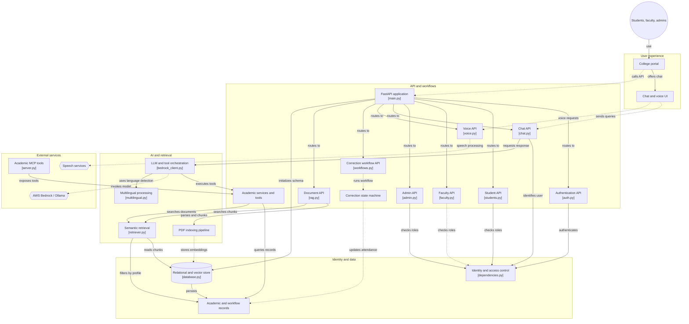

# CampusAI: Production-Grade Agentic College Assistant
> Inspired by Campx Medha. Built with Next.js, FastAPI, Ollama, AWS Bedrock, Amazon Translate, LangGraph, and PostgreSQL pgvector.

[](https://gitdiagram.com/shakeer7/campusai?utm_source=readme&utm_medium=picture)



[](https://github.com/shakeer7/campusai/actions/workflows/deploy.yml)
[](http://a783316d36dde478d881389cc73a62a8-904703005.us-east-1.elb.amazonaws.com)

**Live Deployment URL**: [http://a783316d36dde478d881389cc73a62a8-904703005.us-east-1.elb.amazonaws.com](http://a783316d36dde478d881389cc73a62a8-904703005.us-east-1.elb.amazonaws.com)

CampusAI is a production-grade, secure, multilingual AI assistant for college management. Designed around a synthetic **Chaitanya Bharathi Institute of Technology (CBIT)** environment, it empowers students, faculty, and administrators with academic records retrieval, 75% attendance calculations, syllabus RAG search, voice interaction, and agentic workflows.

---

## 🚀 Key Capabilities

- 🎓 **Student Experience**: Attendance analytics, 75% consecutive class calculator, interactive weekly timetables, semester grades & SGPA/CGPA breakdown, ERP fee tracking, and student profile/roll number lookup.
- 🦙 **Ollama & Bedrock Dual-LLM Support**: Seamlessly switch between local/cluster-hosted Ollama models (`llama3.2`, `mistral`) and AWS Bedrock Converse (`claude-3-5-sonnet`) with autonomous tool calling.
- 🌐 **Multilingual & Hinglish AI**: Understands natural English, Romanized Hindi (Hinglish like *"meri attendance kitni hai"*, *"mere roll no kya hy"*), Romanized Telugu (Tenglish like *"Naku attendance entha undi?"*), Telugu script, and Hindi Devanagari.
- 🌍 **AWS Translate Neural Integration**: Integrated with Amazon Translate (`translate:TranslateText`) for instant cross-lingual translation.
- 👨‍🏫 **Faculty Portal**: Assigned subjects overview, class rosters, attendance management, and human-in-the-loop review for attendance discrepancy requests.
- 🛡️ **Administrator Portal**: System health monitoring, audit trail viewer, role-based access control, and AI telemetry.
- 🤖 **Agentic LangGraph Workflow**: Multi-step attendance correction state machine with draft preview, student confirmation, faculty routing, and automated attendance record update.
- 📚 **Academic RAG Pipeline**: PDF text extraction, chunking, AWS Bedrock Titan Embeddings v2, prompt injection neutralization, and pgvector semantic retrieval.
- 🔌 **Model Context Protocol (MCP)**: Standalone Python MCP server exposing academic tools for LLMs.
- ☁️ **AWS Cloud Deployment**: EKS v1.34 cluster with `c7i-flex.large` nodes, RDS PostgreSQL 16 + pgvector, S3 encrypted storage, and AWS Internet-Facing Load Balancer.

---

## 👥 Demo Accounts (Pre-Seeded)

| Role | Email | Password | Details |
|:---|:---|:---|:---|
| **Student (Eligible)** | `student@cbit.ac.in` | `Student@123` | Rohan Reddy (Roll: `160121733001`, 78% Attendance, 8.72 CGPA) |
| **Student (Warning)** | `ananya@cbit.ac.in` | `Student@123` | Ananya Sharma (Roll: `160121733045`, 68% Attendance, Target Demo) |
| **Faculty Member** | `faculty@cbit.ac.in` | `Faculty@123` | Dr. K. Srinivas (HoD CSE, Emp: `CBIT-FAC-0104`, Approver) |
| **Administrator** | `admin@cbit.ac.in` | `Admin@123` | CBIT IT Operations (Audit Logs & System Stats) |

---

## 🛠️ Local Development & Quickstart

### Prerequisites
- Python 3.12+
- Node.js 18+
- Docker & Docker Compose (Optional for container stack)

### 1. Clone & Set Up Backend

```bash
cd campusai/backend

# Create virtual environment
python -m venv .venv
source .venv/bin/activate  # On Windows: .venv\Scripts\activate

# Install dependencies
pip install -r requirements.txt

# Run database seeder (initializes SQLite or PostgreSQL)
python ../database/seed/seed_data.py

# Run backend test suite
pytest tests/ -v

# Start FastAPI backend
uvicorn app.main:app --reload --port 8000
```
API Documentation will be available at `http://localhost:8000/docs`.

### 2. Set Up Frontend

```bash
cd campusai/frontend

# Install dependencies
npm install

# Start Next.js development server
npm run dev
```
Open `http://localhost:3000` in your browser.

---

## 🐳 Docker Compose Stack

Run the entire multi-container architecture (PostgreSQL with pgvector, FastAPI, Next.js, MCP Server, Prometheus, and Grafana) with a single command:

```bash
docker-compose up -d
```

---

## 🧪 Automated Test Verification

All 32 unit, integration, and security tests can be verified with:

```bash
pytest campusai/backend/tests -v
```

Test coverage includes:
- Attendance target math (exact 75%, shortage, excess classes).
- Authentication & JWT token issuance.
- Role-Based Access Control (RBAC) and student data isolation.
- AI tool execution and session-based identity resolution.
- RAG chunking and prompt injection neutralization.
- LangGraph attendance correction state machine lifecycle.

---

## ☁️ Terraform & AWS Free Tier Deployment

See the comprehensive [AWS Free Tier Guide](docs/deployment/aws-free-tier-guide.md) for step-by-step instructions on deploying CampusAI with $0.00 cloud cost using `db.t4g.micro` and single-AZ Free Tier profiles.
