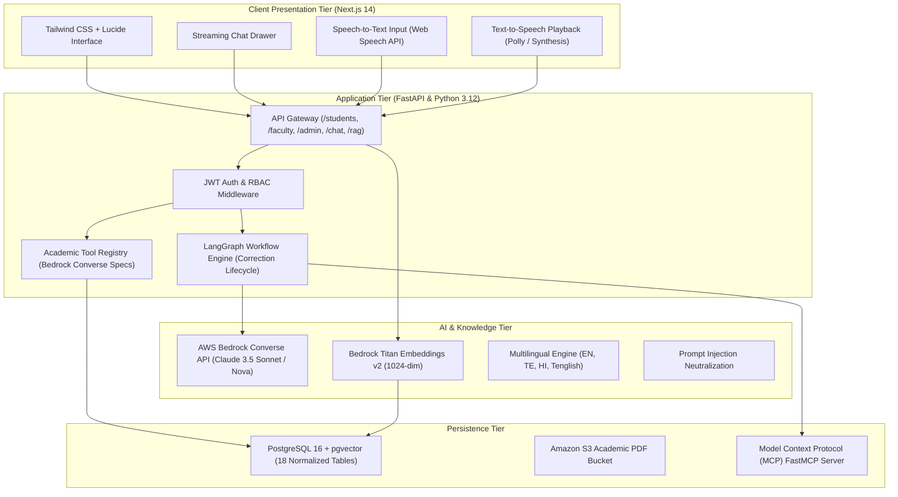

# CampusAI: Architecture & System Design Specification

CampusAI is a high-availability, agentic college management assistant built for Chaitanya Bharathi Institute of Technology (CBIT). It provides real-time academic record lookups, 75% attendance calculations, syllabus RAG grounding, LangGraph stateful approval workflows, and multilingual speech interaction.

---

## 1. Multi-Tier System Topology

---

## 2. Key Architecture Pillars

### A. Academic Identity & Zero-Trust Session Resolution
Never trust a student ID or roll number passed as a prompt parameter by an LLM. All tool handlers resolve the target student or faculty profile directly from the validated JWT token session (`current_user.id`).
- Student A cannot view Student B's grades, fee accounts, or timetable.
- Students cannot invoke faculty approval or rejection tools (enforced with HTTP 403 Forbidden).

### B. 75% Attendance Mathematical Logic
The college enforces a strict 75% minimum attendance rule for semester-end examination eligibility:
$$\text{Current Attended } A, \quad \text{Current Total } T, \quad \text{Target } P = 75\%$$

1. **When $A/T < P/100$ (Shortage):**
   Number of upcoming consecutive classes $x$ needed without absence:
   $$x = \left\lceil \frac{P \cdot T - 100 \cdot A}{100 - P} \right\rceil$$

2. **When $A/T \ge P/100$ (Compliant):**
   Number of classes $y$ the student can safely miss:
   $$y = \left\lfloor \frac{100 \cdot A - P \cdot T}{P} \right\rfloor$$

### C. LangGraph Attendance Correction Workflow
State machine with 12 distinct steps and **Human-in-the-Loop** confirmation:
1. Student triggers intent: *"I was absent yesterday in Data Structures; please fix it."*
2. System extracts subject, date, and period.
3. System verifies against existing attendance log in database.
4. System identifies the assigned faculty member from the timetable.
5. System drafts ticket preview with student details.
6. **Interrupt**: System halts and prompts student for explicit confirmation.
7. Upon confirmation, ticket is lodged in `correction_requests` table with status `pending_faculty_approval`.
8. System sends notification to the assigned faculty member.
9. Faculty logs into portal, reviews the student's justification, and enters review remarks.
10. If approved: system updates the official `attendance_records` status to `PRESENT`.
11. If rejected: absence is preserved with faculty notes.
12. Immutable audit entry recorded in `audit_logs`.

### D. Multilingual Detection & Prompt Routing
Input messages are analyzed via regex and Unicode inspection:
- `\u0C00-\u0C7F`: Native Telugu script
- `\u0900-\u097F`: Native Devanagari Hindi script
- Vernacular markers (`naku`, `undha`, `cheppandi`, `enti`, `classlu`): Romanized Telugu (Tenglish)
- Default: English

Responses are generated in the matched tongue while retaining standardized university terminology.
