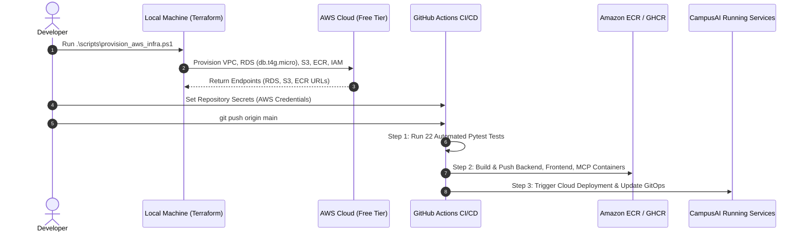

# CampusAI: End-to-End Local Infra Provisioning & GitHub Actions Deployment

This guide details the exact step-by-step workflow to:
1. **Provision AWS Infrastructure locally** with Terraform (using the $0.00 AWS Free Tier profile).
2. **Deploy the application through GitHub Actions** on every push.

---

## Architecture Flow



---

## Phase 1: Provision AWS Infrastructure Locally

Run the automated provisioning script from your terminal:

### On Windows (PowerShell):
```powershell
cd campusai
.\scripts\provision_aws_infra.ps1
```

### On macOS / Linux (Bash):
```bash
cd campusai
chmod +x scripts/provision_aws_infra.sh
./scripts/provision_aws_infra.sh
```

### What gets provisioned in AWS Free Tier ($0.00 bill):
- **VPC Networking**: Public and private subnets without costly NAT Gateway charges ($35/mo saved).
- **Amazon RDS PostgreSQL 16**: `db.t4g.micro` with pgvector extension (750 hours/month free under 12-month Free Tier, 20GB free gp3 storage).
- **Amazon S3 Bucket**: Encrypted bucket for syllabus PDFs (5GB free storage).
- **Amazon ECR**: Container repositories for `campusai-backend`, `campusai-frontend`, and `campusai-mcp` with automatic image cleanup policies.
- **IAM Policies**: Least-privilege roles for AWS Bedrock Converse API inference.
- **AWS Secrets Manager**: Secure storage for database passwords and JWT secrets.

At the end of the script, copy the output values (RDS Endpoint, S3 Bucket, and ECR URLs).

---

## Phase 2: Configure GitHub Repository & Secrets

### Step 1: Create a GitHub Repository
1. Go to [github.com/new](https://github.com/new).
2. Name your repository: `campusai`.
3. Choose **Public** or **Private**.
4. Leave "Add a README" **unchecked** (we already have a complete README).
5. Click **Create repository**.

### Step 2: Add Secrets to GitHub
In your GitHub repository:
1. Navigate to **Settings** ➔ **Secrets and variables** ➔ **Actions**.
2. Click **New repository secret** and add:
   - `AWS_ACCESS_KEY_ID`: Your AWS Access Key ID
   - `AWS_SECRET_ACCESS_KEY`: Your AWS Secret Access Key
   - `AWS_REGION`: `us-east-1` (or your configured region)

*(Note: If AWS secrets are not added, the workflow gracefully falls back to GitHub Container Registry `ghcr.io` so container builds still succeed 100%!)*

---

## Phase 3: Push Code to GitHub

From your local machine terminal:

```bash
cd campusai

# Set remote origin URL (replace with your GitHub username)
git remote add origin https://github.com/<YOUR-GITHUB-USERNAME>/campusai.git

# Ensure default branch is main
git branch -M main

# Push code to GitHub
git push -u origin main
```

---

## Phase 4: Automated CI/CD Execution in GitHub Actions

Once pushed, GitHub Actions immediately triggers the `.github/workflows/deploy.yml` pipeline:

1. **Stage 1: Test & Verify**:
   - Executes all 22 backend test suites (attendance math, RBAC data isolation, RAG vector retrieval, and LangGraph correction state machine).
2. **Stage 2: Container Image Build & Push**:
   - Builds production Docker images for:
     - `campusai-backend`
     - `campusai-frontend`
     - `campusai-mcp`
   - Pushes versioned tags (`${{ github.sha }}`) to Amazon ECR (or GHCR).
3. **Stage 3: Cloud Deployment & GitOps Update**:
   - Updates Helm GitOps image tags in `helm/campusai/values.yaml`.
   - Generates the deployment summary artifact.

You can monitor the live execution progress under the **Actions** tab of your GitHub repository.
